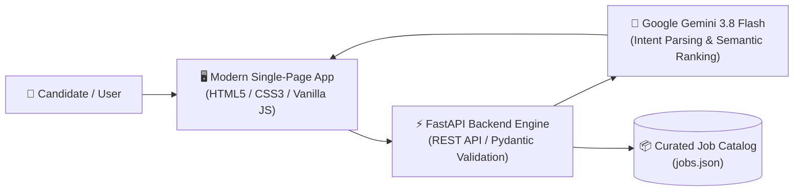

<div align="center">

# ✦ JobPulse AI
### *Autonomous Semantic Job Discovery & Application Platform*

[](https://fastapi.tiangolo.com/)
[](https://aistudio.google.com/)
[](https://python.org)
[](LICENSE)

<p align="center">
  <b>Find jobs around what you actually want next.</b><br/>
  Powered by <b>Google Gemini 3.8 Flash</b>, JobPulse AI understands conversational search queries, matches candidate resumes against open roles, explains <i>why</i> a job fits, and generates personalized application pitches in one click.
</p>

[Key Features](#-key-features) • [Architecture](#-architecture) • [Getting Started](#-getting-started) • [API Reference](#-api-endpoints) • [Tech Stack](#-tech-stack)

---

</div>

## 🚀 Key Features

- **🔍 Natural Language Semantic Search**: Search using conversational requirements (*"Remote Python engineer working on LLMs"*, *"Entry-level frontend developer who knows Next.js"*). Gemini parses intent beyond simple keyword matching.
- **📄 Instant Resume Matching**: Paste raw resume text or your technical skills. Gemini evaluates your experience against role specifications and returns ranked matches with percentage scores.
- **✦ Explainable Fit Rationale**: Every recommendation includes a dedicated *"✦ Why this fits"* breakdown written in real time by Gemini, explaining technical synergy and growth potential.
- **✉️ Automated AI Cover Letter & Pitch Generator**: Select any job and click **Generate Pitch with Gemini** to produce a concise, compelling 3-paragraph application pitch customized for that specific team.
- **🎯 Real-Time Multi-Criteria Filters**: Filter by Category (`AI / ML`, `Frontend`, `Backend`, `Design`, `DevOps`, `Data`), Remote-first status, and minimum salary thresholds.
- **🛡️ Graceful Upstream Recovery**: Includes intelligent local heuristic fallback scoring, ensuring zero UI downtime even during upstream provider rate limits or network spikes.

---

## 🏗️ Architecture



---

## 🛠️ Tech Stack

| Layer | Technologies |
| :--- | :--- |
| **AI / LLM Engine** | **Google Gemini 3.8 Flash** (`google-genai` SDK) |
| **Backend Framework** | **FastAPI**, **Uvicorn**, **Pydantic** |
| **Frontend** | **HTML5**, **Modern Responsive CSS (Inter)**, **Vanilla ES6+ JavaScript** |
| **Data Storage** | Lightweight structured JSON store |
| **Environment & Config**| **python-dotenv** |

---

## 📂 Project Structure

```
jobpulse/
├── app.py              # FastAPI server, REST API, & Gemini orchestration
├── jobs.json           # Catalog of roles (AI/ML, Full Stack, Backend, Design, Data)
├── static/
│   ├── index.html      # Responsive single-page interface
│   ├── style.css       # Clean, modern design system
│   └── app.js          # Client-side state, API calls, & DOM rendering
├── .env.example        # Environment variable template
├── .gitignore          # Prevents committing secrets or cache files
├── test_app.py         # Automated integration test suite
└── README.md           # Documentation
```

---

## ⚡ Getting Started

### 1. Clone the Repository
```bash
git clone https://github.com/ArjunPundir231105/jobpulse.git
cd jobpulse
```

### 2. Set Up Virtual Environment & Dependencies
```bash
python -m venv venv
# On Windows:
.\venv\Scripts\activate
# On macOS/Linux:
source venv/bin/activate

pip install fastapi uvicorn google-genai pydantic python-dotenv
```

### 3. Configure Gemini API Key
Create a `.env` file in the project root:
```env
GEMINI_API_KEY=your_gemini_api_key_here
PORT=8000
HOST=127.0.0.1
```
> **Tip:** You can obtain a free API key at [Google AI Studio](https://aistudio.google.com/). You can also input your API key directly in the web UI using the top navigation bar.

### 4. Run the Application
```bash
python app.py
```
Open **[http://localhost:8000](http://localhost:8000)** in your browser.

### 5. Run Integration Tests
```bash
python test_app.py
```

---

## 🔌 API Endpoints

| Method | Endpoint | Description |
| :--- | :--- | :--- |
| `GET` | `/api/config` | Returns system status and active Gemini model configuration |
| `GET` | `/api/jobs` | Fetches filtered catalog of job listings |
| `POST` | `/api/search-ai` | Executes semantic natural language / resume matching via Gemini |
| `POST` | `/api/generate-cover-letter` | Generates a tailored 3-paragraph application pitch for a specific role |
| `POST` | `/api/set-key` | Dynamically updates runtime Gemini API key |

---

## 📸 Sample Queries to Try

- `"Remote Python engineer working on LLMs"`
- `"Entry level junior backend developer"`
- `"Staff distributed systems engineer with Go and Kafka"`
- `"Senior product designer with Figma and design systems experience"`

---

## 📄 License

This project is open-source under the [MIT License](LICENSE).
